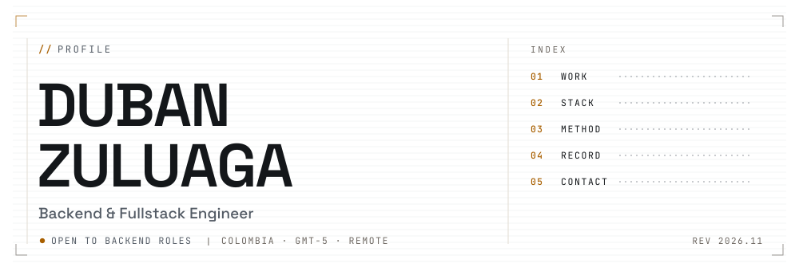
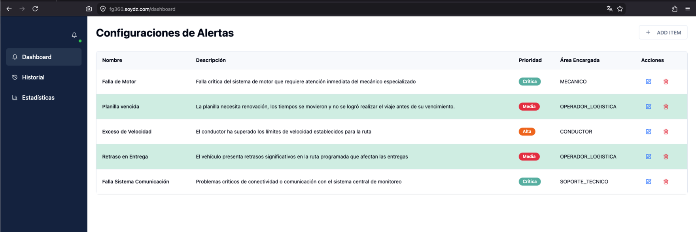
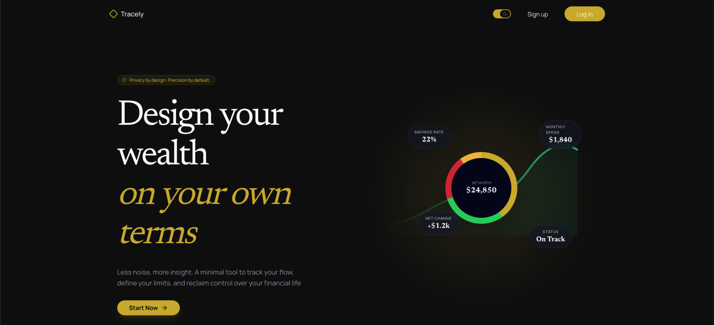
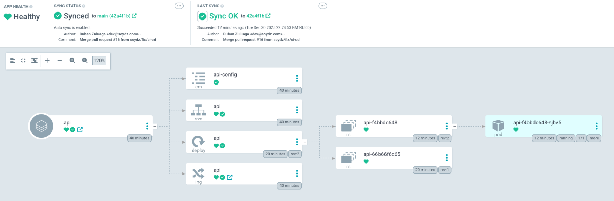

<picture>
  <source media="(prefers-color-scheme: dark)" srcset="https://raw.githubusercontent.com/soydz/soydz/main/assets/header-dark.svg">
  <source media="(prefers-color-scheme: light)" srcset="https://raw.githubusercontent.com/soydz/soydz/main/assets/header-light.svg">
  
</picture>

I build the parts you only notice when they break: auth, queues, deploys.

## Selected work

### Fleet Guard 360 BACKEND · DEVOPS

`Java 21` `Spring Boot` `GraphQL` `RabbitMQ` `PostgreSQL` `Docker`

Five Spring Boot services behind a JWT gateway. A new alert fans out over RabbitMQ to persistence and to a STOMP/WebSocket push, so the operator sees it before the email lands.

**Inside:** 5 services · 3 Postgres instances · 2 isolated Docker networks · GitHub Actions to GHCR

[Source](https://github.com/soydz/fleet-guard-360) · [Architecture](https://github.com/soydz/fleet-guard-360#architecture)

### Tracely FRONTEND · PRODUCT

`TypeScript` `Next.js` `React` `TanStack Query` `Zod` `Tailwind`

A finance tracker that is type-safe end to end: Zod schemas at the boundary, TanStack Query for server state, and a feature-based layout where each domain owns its API, hooks and UI.

**Inside:** feature-based architecture · type-safe transaction lifecycle · budgets · analytics

[Live](https://tracely.soydz.com) · [Source](https://github.com/soydz/tracely)

### PT Supermercado BACKEND · PLATFORM

`Java` `Spring Boot` `PostgreSQL` `K3s` `Argo CD` `SonarCloud`

A sales API for a supermarket chain, shipped the way I would ship it for real: Argo CD reconciles the cluster from git, Postgres runs on a StatefulSet, and quality gates run on every build.

**Inside:** GitOps deployment · SonarCloud quality gates · OpenAPI + Scalar docs · rootless Podman builds

[Source](https://github.com/soydz/pt-supermercado)

## Stack

**Daily** · `Java` `Spring Boot` `TypeScript` `PostgreSQL` `Git`

**Regular** · `React` `Next.js` `Docker` `Podman` `RabbitMQ` `GraphQL` `GitHub Actions`

**Shipped with** · `Kubernetes` `Argo CD` `Nginx` `Svelte` `C`

## Method

**Auth at the edge.** The gateway validates the token once; downstream services never re-check it. One place to audit, one place to break.

**Async by default.** A published alert reaches persistence and push independently. A slow mail server cannot block an incident.

**Deploy by pipeline.** Merges build the image, Argo CD applies the cluster. Nothing lands in production by hand.

## Record

**2023 – now** · Systems Engineering, Universidad de Antioquia 
**Nov 2025** · Red Hat System Administration I (RH124) 
**Nov 2025** · Red Hat OpenShift Development I (DO188)

## Contact

[soydz.com](https://soydz.com) · [LinkedIn](https://www.linkedin.com/in/dubanzuluaga) · [Email](https://soydz.com/#transmission_protocol) · [CV](https://soydz.com/CV-English.pdf)

<strong>More work</strong>

 

**Global Renewable Energy Monitoring** · `Java` `TypeScript`
REST API and client for global solar, wind and hydro production data. [Backend](https://github.com/soydz/renewableEnergiesBackend) · [Frontend](https://github.com/soydz/renewableEnergiesFrontend)

**Personal Financial Management** · `TypeScript`
Budget and expense tracking with a typed data layer. [Source](https://github.com/soydz/personal-financial-management)

**Stockflow** · `TypeScript`
Inventory movement tracking. [Source](https://github.com/soydz/stockflow)

**Unix shell and utilities** · `C`
A shell built from scratch (fork/exec, pipes, redirections) plus reimplementations of `cat`, `grep`, `zip` and `unzip`. [Shell](https://github.com/soydz/so-lab2-unix-shell) · [Utilities](https://github.com/soydz/so-lab1-unix-utilities)

